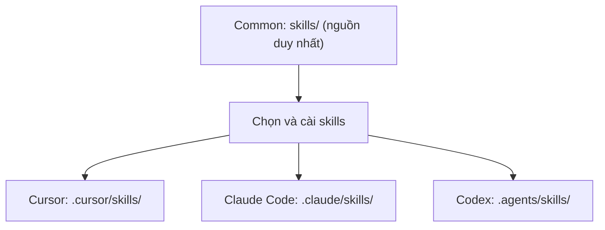

# dotnet-backend-common

**Bộ kỹ năng AI Coding cho ASP.NET Core / .NET** — dùng được với **Cursor, Claude Code và Codex**.

> **Mục tiêu:** AI viết code dễ đọc, dễ test, đúng kiến trúc của từng project; không tự thêm CQRS, MediatR, Generic Repository hay Clean Architecture khi chưa cần.

**Phiên bản:** `2.2.1` · **Không** phải thư viện NuGet hay framework runtime. Common cung cấp skills, quy tắc kỹ thuật, ví dụ và công cụ kiểm tra.

## 1. Common hoạt động thế nào?



Skills hướng dẫn **cách AI thực hiện công việc**. Project của bạn vẫn quyết định kiến trúc, API contract, database-first/code-first, authentication và quy tắc nghiệp vụ trong `AGENTS.md` hoặc tài liệu riêng. Bộ cài **không ghi đè** các file đó.

## 2. Cài nhanh

**Yêu cầu:** Node.js 22/24, Python 3.11+; thư mục project đích phải tồn tại. .NET SDK chỉ cần khi chạy ví dụ hoặc build/test ứng dụng.

**Windows PowerShell** (ví dụ cài 3 skills nền tảng cho Codex):

```powershell
git clone https://github.com/Trinhduyet/dotnet-backend.git dotnet-backend-common
cd dotnet-backend-common
python -m venv .venv
.\.venv\Scripts\Activate.ps1
python -m pip install -r requirements-validation.txt
node scripts/install.mjs --agent codex --target ..\my-api --skills dotnet-development,dotnet-code-review,dotnet-testing --dry-run
node scripts/install.mjs --agent codex --target ..\my-api --skills dotnet-development,dotnet-code-review,dotnet-testing
```

**Linux/macOS** (ví dụ cho Claude Code):

```sh
git clone https://github.com/Trinhduyet/dotnet-backend.git dotnet-backend-common
cd dotnet-backend-common
python3 -m venv .venv
. .venv/bin/activate
python -m pip install -r requirements-validation.txt
node scripts/install.mjs --agent claude --target ../my-api --skills dotnet-development,dotnet-code-review,dotnet-testing --dry-run
node scripts/install.mjs --agent claude --target ../my-api --skills dotnet-development,dotnet-code-review,dotnet-testing
```

- Đổi `--agent` thành `cursor`, `claude` hoặc `codex` tùy công cụ.
- `--dry-run` chỉ xem trước; bỏ tùy chọn này để cài.
- Các lệnh trên clone `main` để thử nghiệm. Với project quan trọng, **checkout commit/tag đã review** trước khi cài.
- Mở lại phiên AI và kiểm tra skill có được phát hiện; copy file thành công chưa chứng minh AI đã sử dụng skill.

Chi tiết Windows/user-level, lỗi cài đặt và rollback: [Hướng dẫn cài đặt](docs/INSTALLATION.md) · [Tương thích công cụ](docs/COMPATIBILITY.md).

## 3. Có những skills nào?

| Skill | Khi nào dùng |
| --- | --- |
| [dotnet-development](skills/dotnet-development/SKILL.md) | Implement hoặc sửa feature .NET |
| [dotnet-code-review](skills/dotnet-code-review/SKILL.md) | Review correctness, security, hiệu năng, kiến trúc |
| [dotnet-testing](skills/dotnet-testing/SKILL.md) | Unit, API integration và regression tests |
| [dotnet-debugging](skills/dotnet-debugging/SKILL.md) | Tìm root cause trước khi sửa bug |
| [dotnet-api-design](skills/dotnet-api-design/SKILL.md) | DTO, HTTP status, validation, ProblemDetails, OpenAPI |
| [dotnet-database](skills/dotnet-database/SKILL.md) | SQL Server, EF Core, database-first, truy vấn |
| [dotnet-deployment](skills/dotnet-deployment/SKILL.md) | Docker, CI/CD, health, readiness, rollback |

**Nên bắt đầu với 3 skills đầu tiên.** Chỉ cài thêm skill khi project thực sự cần. Mỗi skill có hướng dẫn độc lập; không yêu cầu đưa toàn bộ Common vào ứng dụng.

## 4. Dùng trong project .NET

1. Giữ nguyên `AGENTS.md`, kiến trúc và tiêu chuẩn bảo mật hiện có của project.
2. Cài skills phù hợp, rồi yêu cầu AI chọn skill theo công việc. Ví dụ:

   > Dùng dotnet-development để thêm endpoint GET /api/items vào code hiện tại. Đọc AGENTS.md trước; giữ Controller → Service → DbContext, DTO rõ ràng, CancellationToken và viết integration test. Không thêm repository/CQRS nếu chưa có yêu cầu.

3. Review diff và chạy **build/test của chính project**. Skill không tự cho phép deploy, sửa database production hay push code.

Project mới: [Getting started](docs/getting-started.md) · Quy ước nền: [Architecture](docs/architecture.md) và [Coding rules](rules/coding.md).

## 5. Ví dụ và kiểm tra chất lượng

| Ví dụ | Minh họa |
| --- | --- |
| [simple-api](examples/simple-api/README.md) | Controller → Service → EF Core/SQLite, DTO, validation, HTTP tests |
| [sqlserver-database-first](examples/sqlserver-database-first/README.md) | SQL script chuẩn, EF mapping, truy vấn có giới hạn |
| [document-upload](examples/document-upload/README.md) | Controller mỏng, giới hạn file, service upload/cleanup |

```sh
node scripts/verify-toolkit.mjs
dotnet test examples/Examples.slnx -c Release --nologo
```

Lệnh đầu kiểm tra skills, installer, references, scripts và evaluation fixtures; lệnh thứ hai cần .NET SDK 10. Test của ví dụ database-first **không thay thế** kiểm thử trên SQL Server thật.

AI harness có [30 evaluation scenarios](evals/README.md), gồm cả trường hợp **không nên kích hoạt skill**. Validator/test fixtures thành công **không có nghĩa** AI đã xử lý đúng bài toán thực tế — cần chạy task với agent và lưu bằng chứng. [Cách đánh giá](docs/SKILL-AUTHORING.md).

File [`.gitlab-ci.yml`](.gitlab-ci.yml) định nghĩa job kiểm tra, nhưng GitHub không tự chạy cấu hình GitLab này. Không có deploy hoặc phát hành marketplace tự động.

## 6. Cập nhật hoặc gỡ skills

```sh
node scripts/install.mjs --agent codex --target ../my-api --status
node scripts/install.mjs --agent codex --target ../my-api --uninstall --dry-run
node scripts/install.mjs --agent codex --target ../my-api --uninstall
```

Để cập nhật, dùng **checkout phiên bản mới đã review** và chạy lại lệnh cài với `--dry-run` trước. Không dùng `--skills` khi update thì giữ lựa chọn cũ. Bộ cài kiểm tra hash để tránh ghi đè file do bạn sửa. Chế độ copy toàn bộ cũ (`.backend-common/`) vẫn được hỗ trợ khi bỏ `--agent`; xem [Installation](docs/INSTALLATION.md).

---

**Tài liệu thêm:** [Development](docs/development-guide.md) · [Database](docs/database-guide.md) · [AI Coding](docs/ai-coding-guide.md) · [Release & migration](docs/RELEASE.md) · [Changelog](CHANGELOG.md) · [Đóng góp](CONTRIBUTING.md) · [MIT License](LICENSE).
