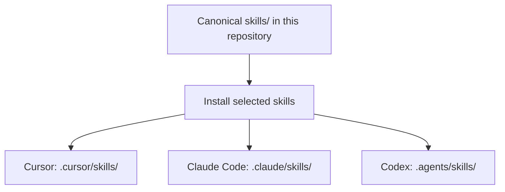

# dotnet-backend-common

**An AI Skills Toolkit for creating and developing .NET applications**, from a new ASP.NET Core API to an existing production codebase. Works with **Cursor, Claude Code, and Codex**.

> Help AI write clear, testable .NET code that follows *your project's architecture*—without forcing CQRS, MediatR, generic repositories, or extra layers.

**Version:** `2.2.3` · Skills guide AI to generate and improve applications; Common is **not** a NuGet package or a `dotnet new` scaffolding template.

## Install in one command

Open a terminal **in your project repository** (new or existing) and run:

```sh
npx -y skills@1.7.6 add Trinhduyet/dotnet-backend
```

Select your coding agent and the skills you need. Start with **dotnet-development**, **dotnet-code-review**, and **dotnet-testing**.

Requires Node.js/npm and Git. No Python environment, manual repository clone, or .NET SDK is needed just to install skills. The command uses the open-source [Skills CLI](https://github.com/vercel-labs/skills), not a custom bootstrap script.

For automated installation, global scope, Windows-specific troubleshooting, version pinning, or the toolkit's hash-protected native installer, see [Installation & updates](docs/INSTALLATION.md).

## How it works



The installer adds skill instructions to your project. It **does not replace** your `AGENTS.md`, business rules, API contracts, security policies, or existing CI/CD pipeline. Your project owns architecture, authentication, database strategy, and deployment decisions.

## Choose your skills

| Skill | Use it for |
| --- | --- |
| [dotnet-development](skills/dotnet-development/SKILL.md) | Creating new .NET applications or implementing features |
| [dotnet-code-review](skills/dotnet-code-review/SKILL.md) | Finding concrete correctness, security, and performance defects |
| [dotnet-testing](skills/dotnet-testing/SKILL.md) | Unit, API integration, and regression tests |
| [dotnet-debugging](skills/dotnet-debugging/SKILL.md) | Reproducing bugs and finding root causes |
| [dotnet-api-design](skills/dotnet-api-design/SKILL.md) | DTOs, validation, HTTP status, ProblemDetails, and OpenAPI |
| [dotnet-database](skills/dotnet-database/SKILL.md) | EF Core, SQL Server, database-first, and query performance |
| [dotnet-deployment](skills/dotnet-deployment/SKILL.md) | Docker, CI/CD, readiness checks, and rollback planning |

Each skill is independently usable. Install only what helps your current project.

## Create a new .NET application

Start in a new project repository, install the skills using the command above, then ask your agent:

> Use dotnet-development to create a small ASP.NET Core Web API for managing items. Choose an installed, supported .NET SDK, use Controllers, Services and request/response DTOs, configure DI and ProblemDetails, propagate CancellationToken, and add runnable HTTP tests. Keep it lean; do not invent authentication, database infrastructure, or extra architecture layers without requirements.

The agent creates the application source; Common supplies its engineering workflow and checks. See [Getting started](docs/getting-started.md) and the [simple-api example](examples/simple-api/README.md).

## Improve an existing .NET project

1. Keep your project instructions and approved architecture.
2. Ask your AI agent to use the relevant skill. For example:

   > Use dotnet-development to add a GET /api/items endpoint. Read AGENTS.md first, follow the existing Controller → Service → DbContext pattern, define a response DTO, propagate CancellationToken, and add an HTTP integration test. Do not introduce new architecture layers.

3. Review the diff and run **your project's** build/test gates before accepting code.

For architecture decisions, see [Architecture](docs/architecture.md) and [Coding conventions](rules/coding.md).

## Runnable examples

| Example | What it shows |
| --- | --- |
| [simple-api](examples/simple-api/README.md) | Controller → Service → EF Core/SQLite, DTOs, and HTTP tests |
| [sqlserver-database-first](examples/sqlserver-database-first/README.md) | SQL schema ownership, explicit EF mapping, and bounded queries |
| [document-upload](examples/document-upload/README.md) | Thin controller, upload limits, service coordination, and cleanup |

Maintainers can verify the toolkit from a reviewed checkout:

```sh
node scripts/verify-toolkit.mjs
dotnet test examples/Examples.slnx -c Release --nologo
```

The first command needs the [validation prerequisites](docs/INSTALLATION.md); the second needs .NET SDK 10. In-memory tests do **not** prove SQL Server-specific behavior.

The [evaluation suite](evals/README.md) includes positive and negative skill-activation cases. Passing static fixtures does **not** prove an AI agent follows a skill; real evaluations require agent traces and executed-test evidence.

## Update or remove skills

Run from the same project:

```sh
npx -y skills@1.7.6 list
npx -y skills@1.7.6 update
npx -y skills@1.7.6 remove dotnet-development
```

These commands manage **Skills CLI installations**. The toolkit's native installer has its own status, update, recovery, and uninstall procedure—do not mix the two managers for the same skill. See [Installation & updates](docs/INSTALLATION.md).

For production adoption, review the source and pin an approved version: the quick command reads the current GitHub source, which may change. Skills are executable instructions with the agent's permissions; neither installation nor validation is a security audit.

---

[Compatibility](docs/COMPATIBILITY.md) · [Skill authoring & evaluations](docs/SKILL-AUTHORING.md) · [Development guide](docs/development-guide.md) · [Database guide](docs/database-guide.md) · [Release & migration](docs/RELEASE.md) · [Changelog](CHANGELOG.md) · [Contributing](CONTRIBUTING.md) · [License](LICENSE)
